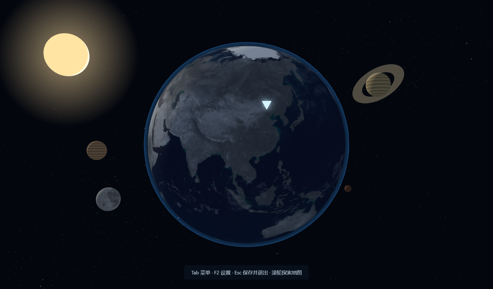

# galaxy-earth · Python世界地图

从宇宙中的地球出发，用探索地图的方式学习 Python 数据分析。Windows 桌面版，中文课程，本地运行代码和保存学习记录。



## 探索方式

地球上的滚轮只控制镜头靠近／远离，不自动跳入亚洲或其他平面地图。靠近后显示洲名，可上下左右拖动旋转地球；只有点击洲名或陆地才进入该洲。进入地图以后，滚轮继续控制国家、省、市／区的逐级浏览。

按 **Tab → 探索七大洲**，可直接进入亚洲、非洲、欧洲、北美洲、南美洲、大洋洲、南极洲。地图页右上方也可切换大洲，不要求先完成课程或手动转动地球。南极洲仅浏览大陆轮廓，不套用国家、省、市行政层级。

首页铺满宇宙场景，不设置常驻侧栏、标题卡片或工具区。地球自动旋转，可拖动旋转、滚轮靠近。点击每日任务箭头，预览「地球 → 云层 → 亚洲 → 中国 → 省份」过场，再进入市／区对应的细分内容。过场目前是首版效果样例，最终演出方式仍待体验反馈确定。

一个省级区域对应一个学习单元。每单元分为认识知识、代码与结果、动手练习、复盘四个学习站点。学完四站，省份从灰色恢复自然色；可以取消标记或重新复习。学习标记不等于已批改或独立掌握。

计划共42个单元（36学习实操、6阶段测试）。中国的34个省级区域已接入；后8个单元的课程已准备，可通过完整路线学习，但周边地图仍待后续拓展。第一站是北京。

**Tab** 前往木星菜单，**F2** 前往土星设置，**Home** 返回地球，**Esc / Alt+F4** 保存后退出。代码区 **Ctrl+Enter** 运行、**Tab** 缩进、**Ctrl+S** 保存。输入文字时保留 Tab 和 Home 的编辑行为。设置页列出完整操作。停笔后自动保存，切换页面和关闭窗口前也会保存。

太阳使用多尺度光球颗粒、暗斑、边缘昏暗和柔和光晕，避免单色圆盘；这是程序生成的表面示意，不是实时太阳观测。太阳为地球提供定向光照。按住左键拖动宇宙空白处，镜头会绕当前观察目标移动位置，从不同角度观察，松开停止，拖动地球仍旋转地球，Home 返回地球视角。星球点击可聚焦；星空使用不同亮度与密度的星点、柔和银河光带及少量亮星光晕。银河也是程序生成的示意，不是真实星图。天体距离与大小为构图调整，不是真实比例或实时星位。每日任务镜头连续推进，不显示阶段字幕。

地图浏览不受学习完成状态限制。点击地球陆地进入所属洲，再点国家、省／州、市／区；滚轮放大深入、缩小返回。地图页的“选择地域”列出当前层级的全部区域，小岛和小市区也能直接进入。国家轮廓改用 Natural Earth 1:50m；各洲使用球面投影，南极使用极区视角，跨日期变更线的岛屿不再被拉到地图两端。

中国省、市边界保存在本地；地级市可继续按需载入区县，直辖市的区县不虚构下一层。香港、澳门入口使用同一套本地省级数据。国外按 geoBoundaries gbOpen 的真实目录逐级请求 ADM1–ADM5，不再固定停在二级；美国的二级是县，不将它统一叫“市”。市区归属按与上级边界的最大重叠面积判定，避免仅仅碰到边界就被归入邻省。数据集可能来自不同年份，查看页保留来源、许可和年份，不承诺实时行政区划。

当前去重后的目录包含232个国家／地区条目、714个行政边界数据集：198个有 ADM1，180个有 ADM2，81个有 ADM3，21个有 ADM4，4个有 ADM5。发现印度的一级目录重复，已去重；塞舌尔采用同一批次的 Regions → Districts，避免旧一级数据与新二级数据的上下级倒置。缺失层级显示明确提示并保留轮廓；网络失败会在地图上方显示错误和重试按钮，加载期间也可取消，不会假装该地区没有下级。南极不套用国家省市层级。

本机已核查并缓存全球清单中可用的一、二级几何数据（约430MB，保存在 D 盘 `assets/boundary-cache`，不上传仓库）；更深层级仍按需下载。源码安装默认按需下载，不要求一次下载全球数据。这些检查不代表全球每个市区都与当前行政区划逐一对照过。

木星菜单内提供 [W3Schools Python](https://www.w3schools.com/python/)（示例与练习）和[菜鸟 Python3](https://www.runoob.com/python3/python3-tutorial.html)（中文讲解）。点击使用本机 Google Chrome 打开，不更改系统默认浏览器；未安装 Chrome 会提示安装，不静默切换其他浏览器。

国外地域名称优先使用 Unicode CLDR 中文名称，并保留原名供核对；没有可靠对应的名称明确标记“中文待核实”，不编造译名。中文词库含5,026项，但不等于全球市区全部已汉化。密集区域按空间避让显示标签，放大可看到更多名称，悬停和地域选择框保留完整名称。台湾归入中国入口，悬停国家显示“中华人民共和国”；台湾省显示20个真实市县边界并支持进一步浏览，金门、连江不计入台湾省列表。

边界读取、裁切和投影在 Web Worker 中处理，避免大型数据阻塞返回、全景和切换大洲。地图底部提供可展开的来源与核验说明。本次检查242个源国家轮廓，222个有可比较的另一来源，另检查202套国家／地区行政数据；151套存在需复核的年份、覆盖范围、上下级归属或几何差异。差异不直接等于边界错误，也不能据此认证为当前官方边界；程序不擅自重绘争议边界。外国数据缺失、历史划分和中文名称缺口仍需持续核对。

## 课程范围

| 单元 | 内容 |
|---|---|
| 1-7 | 变量、数字与文字、列表字典、判断、循环、函数及测试 |
| 8-14 | Pandas、CSV/Excel、筛选、排序、新增列及测试 |
| 15-21 | 类型、缺失、去重、日期、文本清洗、质量核验及测试 |
| 22-28 | 分组、条件计数、连接、防重复计算、透视与排名及测试 |
| 29-35 | 环比、累计、滚动、图表、统计概览、留存及测试 |
| 36-42 | 批量文件、流程函数、SQL衔接、社媒与游戏示例项目、交付及测试 |

每单元按约45-60分钟安排；实际进度按掌握情况调整。业务数据为明确标注的教学示例，不冒充企业真实数据。

## Windows 本地启动

已安装桌面版：运行 `打开Python世界地图.cmd` 或桌面的“Python世界地图”图标。

从源码准备：将项目放在 D 盘，使用 PowerShell 运行 `准备桌面版.ps1`。脚本下载官方 Electron、官方 Python 嵌入式运行时与依赖，素材来自下列公开来源；下载与数据默认放在项目目录。首次准备需要网络，完成后可离线学习。若运行环境已有文件，脚本不会覆盖学习记录。

```powershell
pwsh -ExecutionPolicy Bypass -File .\准备桌面版.ps1
```

## 本地数据

`data/progress.json` 保存代码、答案、笔记与进度；`backups/` 保存修改前的备份；`workspace/` 是 Python 练习工作目录。导出按钮会生成 `.py` 和答案笔记文本。版本校验阻止旧页面覆盖较新的答案。上述私人目录、浏览器配置与运行时不上传仓库。

运行按钮执行本机 Python，不是隔离沙箱，仅运行可信的练习代码。单次运行限制20秒，图表会显示在结果区。

## 独立应用与每日逐句理解题

Python世界地图独立安装在 `D:\Python世界地图`，不属于 SQL 紫笺，不读取其手记或数据库。已准备的桌面版自带 Python、Pandas 和绘图库，无需另装 Python，也不需要 DataGrip、外部编辑器或手动贴运行截图。

42个单元的“动手练习”前各有一道理解题：先给一整段需求，每句话对应一个步骤；每次只提交当前一步。答对自动接入代码并进入下一句；未通过会指出可核对的变量、数值、条件或语法问题，提供参考，点击采用后记为“纠正”，不冒充独立答对。函数、循环、with 等复合语句允许一次提交完整多行代码块。原有每日题目保留，不强制锁住。

判题为离线 Python 语法树规则，不是联网 AI，不执行提交内容。它忽略空格、引号、注释和关键字参数顺序差异，但不是通用等价程序证明器；不能确认的其他写法显示“待复核”，不直接声称算法错误。题面明确约定变量名、参数和写法，首次答案、纠正及当前输入均自动保存。

直接在 App 右侧编写 Python 并点“运行代码”；使用 `print(...)` 显示文字，使用 `display(df)` 把 DataFrame 显示成结果表，Matplotlib 图表自动显示。表格最多展示200行、50列并注明总规模。最近一次运行的源代码、输出、错误、表格及图表保存在当前单元，返回后恢复，不自动重新执行。图片保存总量上限约6MB，超出会提示；不保存无限历史截图。理解题的“运行目前代码”不会覆盖右侧已有草稿。

`node test-guided.cjs` 检查42单元181个参考步骤、空格/注释兼容、语法错误、参考纠正、首次记录、草稿保留以及表格／报错／图表的保存恢复。测试使用隐藏窗口与独立 QA 数据，不修改用户进度。

## 视觉与地理说明

地球影像、海陆轮廓、云层使用公开素材。星空为程序生成的视觉场景，其他天体大小和距离为可看性调整，行星外观含示意纹理，不表示真实即时星位。中国地图用于学习探索，不作导航或测绘依据。市／区只是课程站点，不要求每个行政区均对应知识点。

## 素材来源

- [Three.js](https://github.com/mrdoob/three.js)，MIT；地球、云层、月球影像取自 r160 的 `examples/textures/planets`。见 `vendor/THREE-LICENSE.txt`。
- [Natural Earth](https://www.naturalearthdata.com/about/terms-of-use/)，公共领域，海陆与世界国家轮廓。
- [Unicode CLDR](https://github.com/unicode-org/cldr)，Unicode-3.0，中文行政区域名称；词库固定版本 `f69257926c43f1cb22cf3fcd93e709a2ca994bb7`，见 `vendor/UNICODE-LICENSE.txt`。
- [geoBoundaries gbOpen](https://www.geoboundaries.org/)，国外行政区边界按各数据集的开放许可证提供；首次按需下载，缓存保留来源和许可名称。
- [ChinaGeoJson](https://github.com/zhChuXiao/ChinaGeoJson)，MIT，省、市、区地理数据。见 `assets/geo-license.txt`。
- [polygon-clipping](https://github.com/mfogel/polygon-clipping)，MIT，用于合并省内行政区轮廓。见 `vendor/POLYGON-CLIPPING-LICENSE.md`。
- [D3 Geo](https://github.com/d3/d3-geo) 与 [D3 Array](https://github.com/d3/d3-array)，用于球面投影、路径和面积计算；许可见 `vendor/D3-GEO-LICENSE.txt`、`vendor/D3-ARRAY-LICENSE.txt`。
- [Tabler Icons](https://github.com/tabler/tabler-icons)，MIT，桌面图标的 planet 图形。见 `assets/TABLER-LICENSE.txt`。
- Electron、Python、Pandas 等依赖各自适用其许可证；下载的桌面运行时保留随附许可证。

## 验证

`test-earth.cjs` 使用隐藏的独立测试窗口和独立数据目录，检查地球加载、亚洲过场、34省份、学习分站、自动保存、完成上色、42课程、Python/Pandas运行、图表与错误反馈。另验证过期版本不能覆盖答案。不会弹出测试窗口打断学习，也不改动 SQL 笔记本。

`test-universe.cjs` 检查太阳、星球菜单、快捷键、无字幕连续过场、国外边界下载和安全退出。`test-wheel.cjs` 使用真实滚轮事件验证全景到市／区的完整往返，以及课程地图上的滚轮入口。全部测试窗口均隐藏。

`test-map-render.cjs` 检查七洲几何是否完整拟合、是否有非法路径及南极的极区视角。`test-admin-boundaries.cjs` 验证共享边界、跨日期变更线、最大重叠归属和请求校验；加 `--live` 会检查美、巴、法、日、南非、澳的真实一级／二级样本及中国市辖区。`test-admin-ui.cjs` 使用隐藏窗口验证六洲样本下钻、法国三级、中国区县、返回、地域选择框和 Chrome 链接。样本验证不冒充全球逐市核验。

更新公开数据目录：运行 `node build-boundary-catalog.cjs`。该操作只刷新 `assets/boundary-catalog.json` 的来源元数据，不下载全球全部几何，也不触碰学习记录。

全量检查：`node audit-global-data.cjs` 逐项校验并缓存清单内可用的一、二级边界；`node test-global-entries.cjs --children` 用隐藏窗口逐一点击七洲国家／地区入口（含跨洲重复），检查地图路径，并对每个有下一层的国外国家选一个省州验证下钻。结果保存在 `qa/global-data-audit.json`、`qa/global-entries.json`，不是后台定时任务，也不等于逐市人工核验。`test-map-status.cjs` 验证加载提示、失败重试、取消后不跳转，以及俄罗斯83个一级区的显示。

`test-map-responsiveness.cjs` 检查英国密集标签、西班牙名称及大型数据取消响应；`test-chinese-taiwan-universe.cjs` 检查中文与原名、西班牙译名不串位、台湾市县、背景镜头拖动及太阳着色器。`audit-country-outlines.cjs`、`audit-boundary-geometry.py` 提供来源轮廓对比、几何有效性和上下级覆盖分析；后者需 NumPy、Shapely，分析不会改写原始边界。
